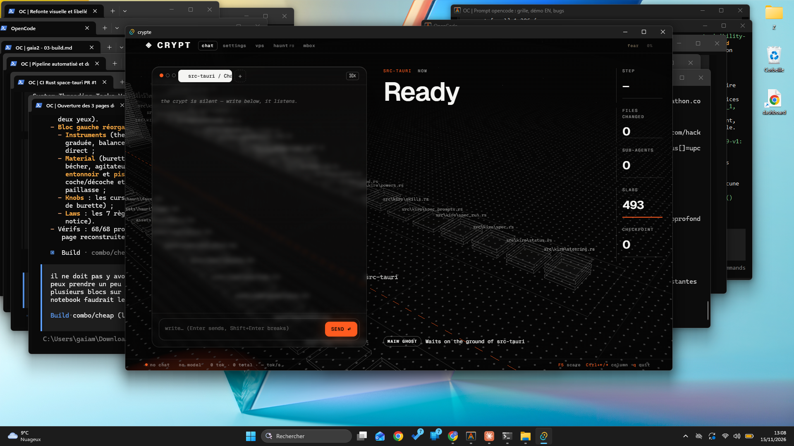
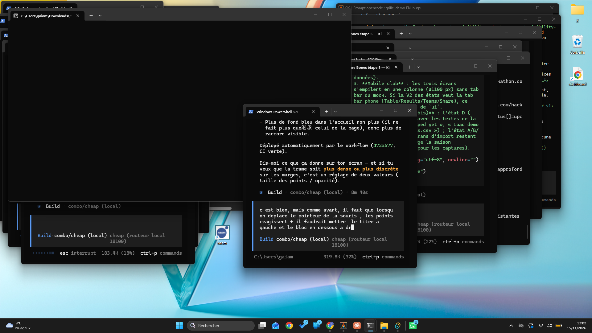

# Crypt

**A chat for coding agents in a haunted crypt: see where your agents
work.** Your projects are drawn as a 3D crypt in the background — folders
are plates on the floor, files are stacks of slabs, and the ghost flies to
whatever the agent touches. Built with Kiro, and it runs your `.kiro/`
itself (steering, specs, hooks, agents, skills, powers, MCP).

| | |
| --- | --- |
| **Download** | <https://github.com/Tradoooo/Crypte/releases/latest> — Windows `.msi`, macOS `.dmg`, Linux `.AppImage` |
| **Quick start** | install, open your project, press **F7** |
| **No API key?** | **Try the demo** — a full agent session replayed offline |
| **How we used Kiro** | [docs/KIRO.md](docs/KIRO.md) |
| **Video** | *(YouTube link — to be added)* |




## Quick start

1. **Install** the bundle for your OS (unsigned build: macOS
   right-click → *Open*, Windows SmartScreen → *More info → Run anyway*).
2. **Launch Crypt inside your project folder** — the folder is the project
   drawn in the 3D crypt.
3. Press **F7**: the 3D crypt turns on and pulls back over **every project
   you run**. **F8** toggles the background, **F5** is a scare, **F9**
   plays Haunt.

### Without an API key (offline demo)

With no provider connected, the chat composer shows **Try the demo**: a
full agent session is replayed — the crypt gets populated, sub-agents are
spawned and delivered, a review chat answers — with zero network and zero
key. `exit demo` returns to your real chats.

### With your own key

Settings → connect any OpenAI-compatible provider (Anthropic, OpenAI,
OpenRouter, Ollama, LM Studio, vLLM…): base URL, masked key (stored in an
encrypted vault, never logged), model. The demo exits by itself the moment
a provider connects.

## Screens

- **Chat** — multi-provider, one model per chat, sub-agents (`/agent`),
  inter-chat bus (`/tell`, `/msg`, `/link`), compaction `/compact`, web
  search `/web`, checkpoints and `/rewind`, memory, a fear gauge and a
  global token counter, Kiro the mascot ghost criticising your prompts.
- **The 3D project space** (F7/F8) — your workspaces as districts of the
  crypt, driven by the `SceneEvent` contract (Rust ⇄ TypeScript).
- **Haunt** (F9) — an original platform/shooter minigame, pixel art.
- **Settings / VPS / Mailbox** — providers and encrypted vault, remote
  sessions, file-backed agent mailbox (P0/P1/P2, orders + acks).

## Kiro

The whole `.kiro/` directory is real and read by the product itself:
steering, hooks (5), custom agents (3), skills (2), workflows (3), a live
EARS spec for the 3D space, powers and MCP — 23 files. The factual
inventory ("what each block prevented or accelerated, with one verifiable
example") is in **[docs/KIRO.md](docs/KIRO.md)**. An example Kiro power is
versioned at [`examples/powers/crypt-scene/`](examples/powers/crypt-scene/)
— install it with the two commands in that folder's README.

## Develop

Prerequisites: Rust stable, Node 22+, the Tauri system libs
(`libwebkit2gtk-4.1-dev libgtk-3-dev libayatana-appindicator3-dev
librsvg2-dev` on Debian). Everything runs from the repository root:

```sh
npm install
npm run tauri dev    # desktop app with hot reload
npm run check        # svelte-check (types) — 0 error expected
npm test             # vitest
npm run build        # static frontend -> build/
cargo fmt --manifest-path src-tauri/Cargo.toml --check
cargo clippy --manifest-path src-tauri/Cargo.toml --all-targets -- -D warnings
cargo test --manifest-path src-tauri/Cargo.toml
```

**The numbers on main**: **469 Rust tests + 47 vitest tests green** (the
CI runs them on every PR), **23 files in `.kiro/`**. The property-based
suites (proptest on the scanner, fast-check on the layout and the tabs)
run in the same commands. The demo video says "448 tests": that figure is
the **terminal build** (`feat/project-space-3d`, the TUI) — TUI + desktop
together, two suites.

## Stack

- Backend: Rust 2021, Tauri v2 (`src-tauri/`, lib `crypte_lib` + `crypte`
  bin)
- Frontend: SvelteKit 2 in static SPA mode (`ssr=false`), Svelte 5 runes,
  Vite, TypeScript strict, Vitest, three.js r187 for the 3D space
- Bridge: ~75 `#[tauri::command]`s + 3 event channels (`crypte-event`,
  `crypte-ui`, `space-event`) — contracts in `src/lib/contracts.ts`

## Data & migration

Paths live under the Tauri app id (`com.crypte.app`):

- config: `$XDG_CONFIG_HOME/com.crypte.app` (`chats.json`, `permissions`,
  `permissions-rules`, `vps.toml`)
- data: `$XDG_DATA_HOME/com.crypte.app` (`providers.enc`, `master.key`,
  `almanac.json`, `checkpoints/`)

First launch auto-migrates (copy-once, never overwrites) from the legacy
TUI paths (`kiro-horror-tui`). Shared, never migrated: the mbox broadcast
dir (`BCAST_DIR`), `~/.config/muse/auth.json`, `~/.kiro/`.

## Rules

- Files < 500 lines AND ≤ 30 functions; functions < 50 lines; zero
  duplication (hooks enforce the budget on every save).
- Colours only through the palette (`src-tauri/src/theme.rs`, the `--cry-*`
  / `--space-*` variables); no sound, ever.
- Secrets never logged (encrypted vault, masked input, redacted `Debug`s);
  no personal path in a tracked file.
- CI: every job ≤ 5 min (`ci-budget` guard); the Mergify queue requires
  `fmt`, `clippy`, `build`, `test` green. Property-based tests run in the
  same commands (hooks + CI).

## License

MIT — see [LICENSE](LICENSE).
